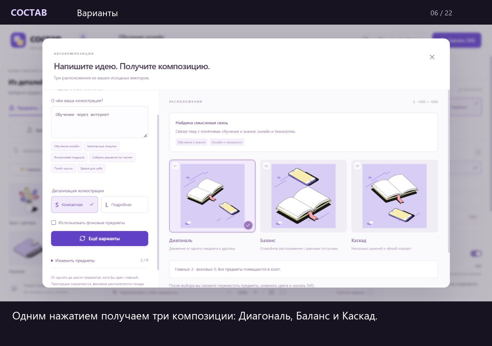

# Состав — конструктор SVG-композиций

«Состав» помогает превратить идею в иллюстрацию из готовых векторных предметов. Введите метафору, заголовок или названия компонентов, выберите композицию и доработайте её на холсте. Размер, палитра и роли предметов переключаются с сохранением исходных контуров и пропорций.

**[Открыть сервис](https://sostav-2bp.pages.dev/)** · [Видеообзор — 2:52](submission/demo-v2.mp4) · [Примеры композиций](#примеры-композиций)

## Возможности

1. **Библиотека SVG.** 10 предметов в размерах S/L и главной/фоновой роли, три встроенные цветовые схемы. Можно загрузить свои SVG и заполнить для них карточки смыслов.
2. **Сборка композиции.** Подбор по фразе или названиям компонентов, три варианта расположения, перемещение, поворот, дублирование, удаление и порядок слоёв. Доступны квадратный, горизонтальный и вертикальный форматы. Палитры загружаются из JSON и автоматически перекрашивают сцену; для своих SVG главная и фоновая карты цветов настраиваются отдельно.
3. **Экспорт и сохранение.** Итог скачивается в SVG с отдельными редактируемыми группами предметов. Перед экспортом проверяются границы, сильные перекрытия и назначения цветов. JSON-проект сохраняет сцену, свои SVG и палитры для продолжения работы.

## Примеры композиций

Ниже — сами SVG-файлы: их можно открыть отдельно или скачать. JSON рядом с каждым примером открывается кнопкой **«Открыть проект»** в редакторе.

<table>
  <tr>
    <th>Обучение через интернет</th>
    <th>Безопасные покупки</th>
    <th>Время для себя</th>
  </tr>
  <tr>
    <td width="33%" valign="top"><a href="submission/examples/learning.svg"></a></td>
    <td width="33%" valign="top"><a href="submission/examples/finance.svg"></a></td>
    <td width="33%" valign="top"><a href="examples/music.svg"></a></td>
  </tr>
  <tr>
    <td>S · 1000 × 1000<br><a href="submission/examples/learning.svg">SVG</a> · <a href="submission/examples/learning.sostav.json">JSON-проект</a></td>
    <td>L · 1200 × 630<br><a href="submission/examples/finance.svg">SVG</a> · <a href="submission/examples/finance.sostav.json">JSON-проект</a></td>
    <td>L · 800 × 1200<br><a href="examples/music.svg">SVG</a> · <a href="examples/music.sostav.json">JSON-проект</a></td>
  </tr>
</table>

Дополнительно: [свой SVG в двух цветовых ролях](submission/examples/custom-roles.svg), [его JSON-проект](submission/examples/custom-roles.sostav.json), [SVG для загрузки](submission/examples/ladder.svg) и [палитра «Лесная»](submission/examples/palette-forest.json).

## Краткое описание архитектуры

**Стек:** React 19, TypeScript, Vite. Приложение опубликовано в Cloudflare Pages; редактирование, подбор предметов и экспорт выполняются в браузере.

| Часть | Как устроена |
| --- | --- |
| **Хранение SVG** | Исходные файлы связаны с ID предметов через `library/source-map.json`. Сборщик создаёт `public/library/catalog.json` и побайтовые копии SVG, проверяет геометрию, цвета и локальные ссылки. Каталог содержит варианты S/L × главная/фоновая роль, размеры и контрольные суммы. |
| **Извлечение элементов** | Клиент загружает каталог. По ID предмета, размеру и роли выбирается соответствующий SVG; по палитре — фон и таблица цветов. Собственные SVG проходят проверку при импорте и добавляются в локальную библиотеку. |
| **Переиспользование SVG** | Экземпляр сцены хранит ссылку на предмет, координаты, угол и роль. Один исходник используется в нескольких экземплярах. Перенос, поворот и масштаб задаются внешней SVG-группой; перекраска меняет цветовые атрибуты. При экспорте внутренние ID и ссылки получают уникальные префиксы, поэтому дубликаты сохраняют свои градиенты и обрезку. |
| **Подбор и компоновка** | Локальные правила связывают слова, сочетания и смыслы с предметами библиотеки. Алгоритм строит три расположения, учитывая размеры, отступы и пересечения рамок. Состав и роли можно исправить вручную. |
| **Сохранение и экспорт** | Сцена автоматически сохраняется в localStorage. Переносимый `.sostav.json` включает свои SVG, их смыслы и цветовые назначения. Холст и экспорт используют общую подготовку вектора; результат содержит исходные контуры в отдельных группах. |

Основные модули: [выбор SVG](src/library/index.ts), [импорт своих SVG](src/library/custom.ts), [модель сцены](src/editor/model.ts), [смысловой подбор](src/editor/meaning.ts), [компоновка](src/editor/layout.ts), [SVG-холст и экспорт](src/editor/svg.ts).

[Подробная архитектура](docs/ARCHITECTURE.md).

## Список AI-инструментов

- **Codex** — анализ материалов, проектирование, написание и исправление кода, подготовка тестов, документации и браузерные проверки. Изменения проверялись автоматическими тестами, сборкой и работой с интерфейсом, включая импорт экспорта в Figma.

Текущий подбор в приложении работает по локальным правилам и карточкам смыслов. Запуск редактора обходится без API-ключей и скачивания модели. Геометрия иллюстраций берётся из SVG-библиотеки.

## Демонстрация

[Посмотреть видеообзор — 2 минуты 52 секунды](submission/demo-v2.mp4). Показаны сборка по фразе, выбор S/L, ручная правка, экспорт и редактирование в Figma, а также свой SVG с двумя цветовыми ролями. Места нажатия выделены, горячие клавиши подписаны.

<details>
<summary>Кадр из видео и ссылка на MP4</summary>

[](submission/demo-v2.mp4)

</details>

## Локальный запуск

Нужен **Node.js 22.12 или новее**; для разработки используется Node.js 24. В PowerShell откройте папку с `package.json`:

```powershell
npm.cmd ci
npm.cmd run dev
```

Откройте [http://127.0.0.1:5173/](http://127.0.0.1:5173/). Для остановки сервера нажмите `Ctrl+C`. На macOS/Linux используйте `npm` вместо `npm.cmd`.

Быстрый сценарий: **«Собрать композицию» → «Обучение через интернет» → S/L → «Построить композицию» → «Открыть в редакторе»**. Нажмите на предмет для правки; `Ctrl+D` создаёт дубликат, `Delete` удаляет, `Ctrl+Z` отменяет действие.

## Проверки и сборка

```powershell
npm.cmd test
npm.cmd run check
npm.cmd run build
npm.cmd run preview
```

75 автоматических тестов покрывают библиотеку, геометрию, цветовые роли, историю, смысловой подбор, компоновку, импорт и экспорт. Последний полный прогон — 75 успешных тестов, production-сборка и проверка типов. Редактирование SVG проверено в Figma.

Готовая сборка находится в `dist/`. [Публикация и обновление Cloudflare Pages](docs/DEPLOYMENT.md) · [результаты проверок](submission/CHECKS.md) · [сквозной сценарий Figma](docs/END-TO-END.md).

## Ограничения

Подбор по фразе зависит от словаря, сочетаний и заполненных смыслов своих SVG; неизвестную тему можно собрать вручную. Для собственного SVG используется одна геометрия в S/L, с отдельными назначениями цветов главной и фоновой роли. Особенности детализации стандартной библиотеки описаны в [SIZE-MAPPING.md](docs/SIZE-MAPPING.md).

Проекты и загруженные SVG хранятся локально в браузере. Для переноса на другое устройство или домен скачайте `.sostav.json`. Импорт принимает автономные статические SVG; текст рекомендуется заранее перевести в контуры. Проверка границ и перекрытий оценивает рамки предметов и не учитывает прозрачные поля. Illustrator отдельно не проверялся.

[Подробная инструкция](docs/USER-GUIDE.md) · [файлы и примеры импорта](submission/README.md).
