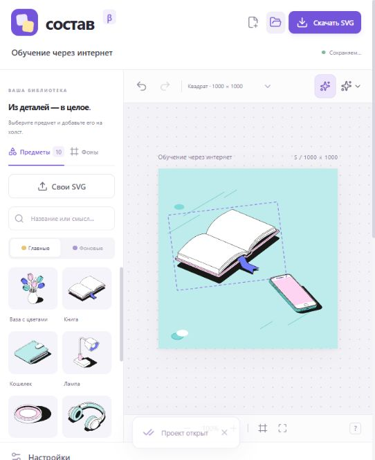

# Публикация в Cloudflare Pages

«Состав» собирается в статические файлы. Для работы редактора не нужны Pages Functions, сервер, API-ключи или база данных. Публикуется содержимое `dist/`.

## Опубликованный сайт

**[https://sostav-2bp.pages.dev/](https://sostav-2bp.pages.dev/)**

Опубликован 3 ноября 2026 года, версия приложения 0.11.2. Pages-проект в аккаунте Cloudflare называется `sostav`; адрес с суффиксом назначен Cloudflare. Использована прямая загрузка ZIP: 51 статический файл, 1 937 424 байта до сжатия. Публичный адрес доступен без входа в Cloudflare или GitHub. Исходный репозиторий остаётся приватным.

Для обновления этого сайта откройте Pages-проект `sostav`, создайте новый production deployment и загрузите свежую сборку по инструкции ниже. Автоматическая публикация при `git push` не подключена.

## Обновление 0.11.3 — 4 ноября 2026

На production опубликована версия 0.11.3. Проверены загрузка новой сборки (`index-8_sry64t.js`), открытие сохранённой сцены с неподдерживаемой историей выбора и двумя ролями своего SVG, повторное сохранение JSON и повторная генерация ручного состава «Книга + Монета». Сцена, свои SVG и обе карты цветов сохранились; неподдерживаемая история отброшена. Консоль браузера без ошибок. Исходная сцена пользователя восстановлена после проверки.

75 автоматических тестов, проверка каталога/типов и production-сборка прошли. В собранном JavaScript отсутствуют ссылки на удалённые экспериментальные компоненты.

## Прямая загрузка готовой сборки

В папке проекта:

```powershell
npm.cmd ci
npm.cmd run check
npm.cmd run build
Compress-Archive -Path dist/* -DestinationPath .build/sostav-pages.zip -Force
```

В Cloudflare откройте **Workers & Pages → Create application → Pages → Direct Upload / Upload assets**. Задайте имя проекта `sostav` (если занято — свободное имя), загрузите ZIP и выполните Deploy. В корне архива должен находиться `index.html`, рядом — `assets/`, `library/` и `favicon.svg`.

После успешного деплоя Cloudflare выдаёт HTTPS-адрес `*.pages.dev`. Обновление выполняется новой сборкой и загрузкой её в тот же Pages-проект. Прямая загрузка не включает автоматические деплои из GitHub.

## Альтернатива: сборка из GitHub

При создании Pages-проекта можно вместо прямой загрузки выбрать **Connect to Git** и репозиторий `Sluchaino/sostav`:

| Параметр | Значение |
| --- | --- |
| Production branch | `main` |
| Root directory | корень репозитория |
| Build command | `npm run build` |
| Build output directory | `dist` |
| Node.js | `24`, также задан в `.node-version` |
| Functions / переменные приложения | не требуются |

На сборочной машине Linux используется `npm`, в Windows PowerShell для локального запуска — `npm.cmd`. Для Git-интеграции потребуется предоставить Cloudflare доступ к выбранному репозиторию. Тип проекта Direct Upload нельзя впоследствии переключить на Git integration: для этого создаётся другой Pages-проект.

## Проверка опубликованного сайта

3 ноября 2026 года на `https://sostav-2bp.pages.dev/` выполнен браузерный проход: библиотека загрузилась, фраза «Обучение через интернет» дала три варианта, выбран размер S, применён вариант, телефон повёрнут на 18°, включена бирюзовая схема. Проверка перед скачиванием не нашла замечаний; реальные SVG и JSON скачаны. JSON повторно открыт, сцена сохранилась после перезагрузки страницы.

Скачанный с сайта SVG проверен отдельно: 1000 × 1000, 156 путей, без растровых `<image>`, поворот телефона 18° сохранён. JSON прошёл `validateScene`, сохранил S, палитру aqua и угол телефона.

Отдельно загружен `ladder.svg` и открыт проект с двумя цветовыми ролями. В бирюзовой схеме DOM холста показал #FFD4F2 / #6D7BFC для главной копии и #5ABEBE / #80DADA для фоновой; в персиковой — #F9ECB0 / #80DADA и #D27532 / #FAC896 соответственно. Консоль браузера без ошибок и предупреждений. После проверки на странице оставлена стандартная композиция; проект на localhost не изменялся.



Перед следующими публикациями повторяйте:

1. Открыть HTTPS-адрес без локального сервера и дождаться библиотеки.
2. «Обучение через интернет» → S → построить → открыть в редакторе.
3. Изменить поворот и палитру, скачать SVG через проверку композиции.
4. Сохранить и повторно открыть JSON-проект.
5. Загрузить свой SVG и проверить главную/фоновую карты цветов.

Библиотека должна загружаться с `/library/`; загрузки и сохранения своих SVG выполняются в браузере. Проекты из localStorage на localhost автоматически не переносятся на новый домен: для переноса откройте скачанный `.sostav.json`.

Официальные инструкции: [Direct Upload](https://developers.cloudflare.com/pages/get-started/direct-upload/), [Git integration](https://developers.cloudflare.com/pages/get-started/git-integration/), [версия Node.js](https://developers.cloudflare.com/pages/configuration/build-image/).
