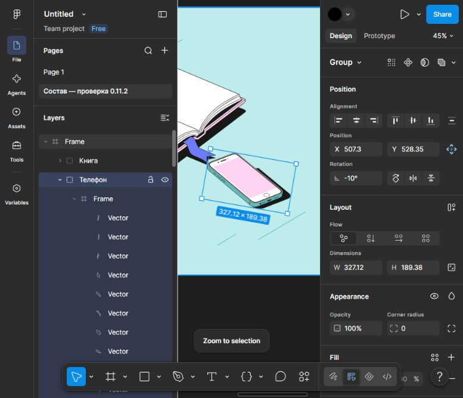
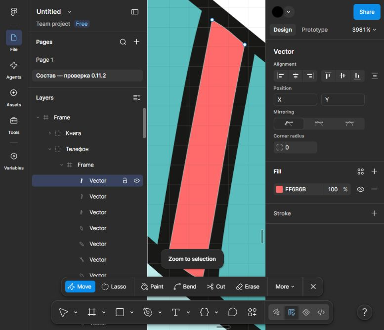
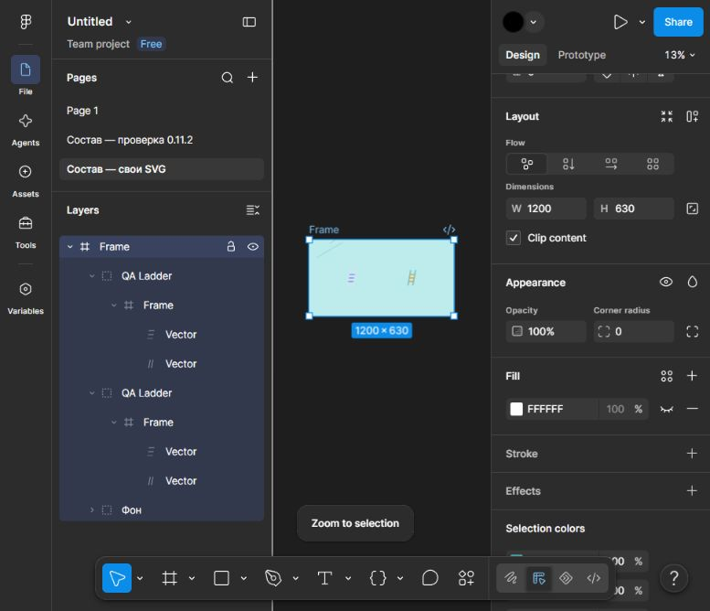

# Сквозная проверка экспорта в Figma

3 ноября 2026 года, приложение 0.11.2, реализация `42054b0`. Проверена production-сборка через `vite preview` на отдельном порту 4197. Проект пользователя на 5173 не изменялся.

Результат: оба сценария прошли. SVG импортируется в Figma с отдельными группами и редактируемыми векторными контурами. Изменений кода приложения не потребовалось.

## Стандартная библиотека

1. В режиме «По смыслу» введено «Обучение через интернет».
2. До построения выбран размер S, построен вариант и открыт в редакторе. Получены книга и телефон.
3. Телефону вручную назначены X = 650, Y = 650, поворот 18°. Выбрана бирюзовая схема, холст 1000 × 1000.
4. Проверка перед экспортом: «Замечаний не найдено». Файл скачан кнопкой сервиса.
5. Содержимое именно скачанного SVG скопировано в буфер и вставлено через интерфейс Figma. XML перед вставкой не переписывался. На отдельной странице созданы Frame 1000 × 1000 и группы «Книга», «Телефон», «Фон».
6. В Figma изменены X телефона и поворот с −18° до −10°. После поворота вокруг центра панель показывает X ≈ 507.30, Y ≈ 528.35. Знак угла в интерфейсе Figma отличается от SVG.
7. У внутреннего слоя Vector заливка FFFFFF заменена на FF6B6B. Открыт режим редактирования узлов с инструментами Move, Lasso, Bend, Cut и Erase. Координаты узлов в этом прогоне не менялись.

В скачанном файле телефон содержит 96 путей, книга — 51; вместе с фоном — 156. Растровых `<image>` и скриптов нет. Transform телефона сохраняет ручные координаты и угол из конструктора.

[Экспорт до правок в Figma](../examples/end-to-end/standard.svg). Правки Figma сохранены в облачном файле, в этот SVG обратно не переносились.

## Свой SVG и две цветовые роли

Загружен `examples/custom/ladder.svg`, имя карточки — QA Ladder, теги «лестница, ступени», смыслы «рост, развитие».

| Исходный цвет | Главная роль | Фоновая роль |
| --- | --- | --- |
| #7353A6 | object.primary | background.strong |
| #F3AD64 | object.secondary | background.medium |

Фоновая раскладка назначена кнопкой «Назначить монохром по яркости», обе карты сохранены. На холст 1200 × 630 добавлена главная копия (350, 315), затем дубликат переведён в фоновую роль и перемещён в (850, 315). Размер L, бирюзовая схема.

В DOM холста и скачанном SVG проверены цвета: главная копия — #FFD4F2 / #6D7BFC, фоновая — #5ABEBE / #80DADA. У обеих по два исходных пути, геометрия сохраняется. Проверка перед экспортом не нашла замечаний. Скачаны SVG и JSON-проект с двумя независимыми картами цветов.

В Figma экспорт вставлен на страницу «Состав — свои SVG»: Frame 1200 × 630, две группы QA Ladder, внутри каждой — отдельные Vector. У одного фонового контура обводка 80DADA заменена на FF8A00. Главная копия сохранила 6D7BFC / FFD4F2. Экземпляры редактируются независимо.

[SVG до правок в Figma](../examples/end-to-end/custom-roles.svg), [переносимый проект](../examples/end-to-end/custom-roles.sostav.json).

## Где посмотреть и границы проверки

[Файл Figma, страница со своим SVG](https://www.figma.com/design/GM8vAK5edNfxDScCfVEuF5/Untitled?node-id=2002-169). Стандартный сценарий — соседняя страница «Состав — проверка 0.11.2». Исходная Page 1 не менялась.

Это ручной сквозной прогон двух сценариев во встроенном Chromium. Illustrator, все комбинации библиотеки и обратный импорт изменений из Figma здесь не проверялись.
