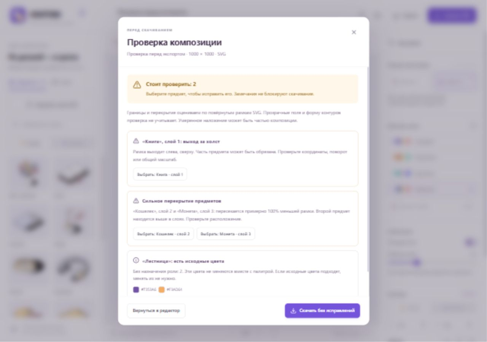

# Итоговая проверка 0.8.1

Дата: 2 ноября 2026 года. Проверена версия 0.8.1, исходная база — коммит `1d37240`, с исправлениями ниже. Среда: Windows, Node.js 24.22.0, браузер Chromium во встроенном браузере приложения. Проверка интерфейса выполнена на production-сборке через `vite preview` на отдельном порту 4196. Пользовательский проект на порту 5173 не изменялся.

## Результат

В проверенных сценариях блокирующих ошибок не обнаружено. Все 65 автоматических тестов проходят, TypeScript и production-сборка успешны. `npm audit` сообщает 0 уязвимостей для основного проекта и отдельного окружения `benchmarks/meaning`, включая их установленные зависимости разработки.

| Проверка | Результат |
| --- | --- |
| `npm test` | 65 passed, 0 failed, 0 skipped |
| `npm run check` | TypeScript и актуальность каталога — успешно |
| `npm run build` | Production-сборка — успешно |
| `npm audit --json` | 0 уязвимостей |
| `npm audit --prefix benchmarks/meaning --json` | 0 уязвимостей |
| Экспорт всех 15 проектов из `examples/` | Проверены 32 группы объектов и все 46 исходных SVG |
| Консоль браузера | Ошибок в собранном приложении не зафиксировано |

Для каждого из 15 проектов отдельно выполнены валидация JSON, экспорт и разбор XML. Проверены число отдельных групп объектов, соответствие размеров холста, отсутствие повторных ID, разрешимость локальных `url(#id)`/`href`, отсутствие `image`, `script`, `foreignObject`. Значения `d` каждого контура объекта сравнивались с соответствующим исходным SVG без изменений. Это дополнительный пакетный проход поверх автоматических тестов.

## Проверка интерфейса

| Сценарий | Наблюдаемый результат |
| --- | --- |
| S/L и роли | Телефон L → S: 155 → 96 контуров. Подставляется исходный SVG; смена роли доступна в подборе и редакторе |
| Форматы | Квадрат 1000×1000, горизонтальный 1200×630, вертикальный 800×1200; размеры SVG соответствуют сцене |
| Редактирование | Координаты 700/400, поворот 25°, дублирование, перестановка слоёв и удаление применяются; undo/redo восстанавливают состав |
| Палитра и фон | Переключение встроенной схемы, отключение фона, импорт и применение «Черничной» палитры работают |
| Сохранение | Скачивание JSON и перезагрузка сохраняют название, предметы, координаты, размер, формат, палитру и состояние фона; открытие проекта-примера восстанавливает сцену |
| Свой SVG | Импорт `examples/custom/ladder.svg`, название, теги и смыслы сохраняются; предмет добавляется на холст |
| Перекраска своего SVG | Назначены две роли. Персиковый предпросмотр даёт `#F9ECB0` / `#80DADA`, активная бирюзовая сцена — `#FFD4F2` / `#6D7BFC`; предпросмотр не переключает схему сцены |
| Правила и исправление | «Платное обучение» даёт книгу и кошелёк; замена кошелька монетой, поиск и добавление телефона, смена его роли на фоновую проходят до генерации |
| Способы сборки | По смыслу, названиям и предметам на холсте создаются по три варианта; применение открывает редактируемую сцену |
| Локальная модель | «Пролить свет на сложный вопрос»: отмена загрузки и повторный запуск работают; предложена лампа. Подсказка и её подтверждение не изменяют холст до применения варианта |
| Происхождение подбора | Скачанный JSON хранит ручные исправления и `model-confirmed`; для модели сохранены подтверждение, score ≈0.586, margin ≈0.145 и закреплённая ревизия |
| Чистая проверка экспорта | Для собранного варианта показано «Замечаний не найдено», файл скачивается |
| Проверка замечаний | `examples/preflight/needs-review.sostav.json`: выход книги за холст, сильное перекрытие кошелька/монеты, исходные цвета лестницы обнаружены |
| Исправление замечаний | Выбор книги переводит фокус на X; «Настроить цвета» открывает назначения цветов с фокусом на палитре предпросмотра |
| Экспорт с замечаниями | «Скачать без исправлений» скачивает SVG; предупреждения не блокируют намеренную композицию |
| Ошибочные файлы | SVG с DTD и JSON с неверной версией отклонены; существующая сцена осталась на месте. Палитра без ролей отклонена, после неё корректная палитра загружается |
| Адаптивность | 390×844 и 1280×900: горизонтального переполнения страницы нет; на узком экране кнопка загрузки сокращена до «Свои SVG», настройки переходят ниже |

Два SVG действительно скачаны через интерфейс и повторно разобраны как XML: исправленный подбор «Платное обучение» — 1200×630, 3 группы, 336 контуров; подтверждённая лампа — 800×1200, 1 группа, 27 контуров. Повторных ID и растровых/исполняемых элементов нет.

## Исправлено при проверке

1. Аудит обнаружил уязвимую транзитивную зависимость `sharp` у `@huggingface/transformers`. В обоих package.json и lock-файлах закреплена исправленная `sharp@0.35.5` через адресный override. Версия Transformers 3.8.1 и ревизия текстовой модели сохранены. `sharp` используется Node-окружением библиотеки и не является обработчиком пользовательских SVG в браузерном редакторе. После обновления аудит чистый, сборка и браузерная подсказка модели работают. Основание версии исправления: [GitHub advisory GHSA-wq5f-xc86-pv6w](https://github.com/advisories/GHSA-wq5f-xc86-pv6w).
2. Ошибки проверки пользовательской палитры показывались на английском. Переведены на русский с пояснениями формата id, цветов и обязательных ролей. Существующие тесты валидации адаптированы к сообщениям; итоговые 65 тестов и сборка повторно прошли. Исправленное сообщение проверено в браузере.

## Границы проверки

- Проверен один движок Chromium и изменение размеров окна. Firefox, Safari и физические мобильные устройства отдельно не тестировались.
- Открытие и редактирование SVG в векторном редакторе пользователь ранее подтвердил. Figma/Illustrator в этой проверке повторно не запускались.
- Качество понимания произвольных метафор не гарантируется этим проходом. Сохранённые сравнительные эксперименты находятся в `benchmarks/meaning`; здесь проверен рабочий сценарий подсказки, отмены и подтверждения, а не новый большой замер точности.
- Для первого запуска модели нужен интернет и крупная загрузка весов/рантайма. Сбой внешнего хостинга и полностью офлайн-первый запуск в этом проходе не моделировались.
- Проверка перекрытий оценивает повёрнутые рамки SVG, а не точные видимые контуры. Свой SVG использует один вариант для S/L и обеих ролей. Это действующие ограничения продукта.
- Сборщик библиотеки сообщает четыре ранее документированных предупреждения об исходных вариантах. Они не скрыты и не стали ошибками сборки; см. README и каталог.
- Это локальная итоговая регрессия; размещение на внешнем хостинге и нагрузочные испытания не выполнялись.
