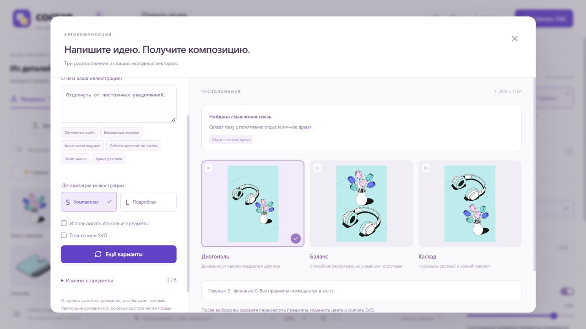
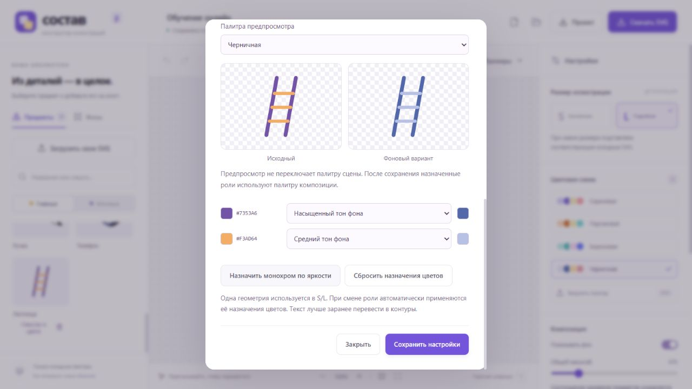
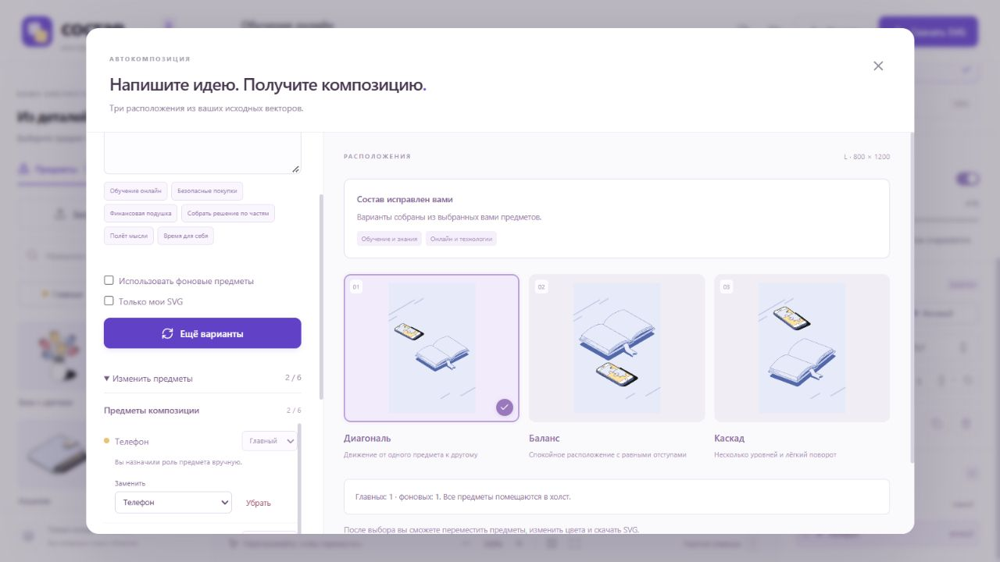
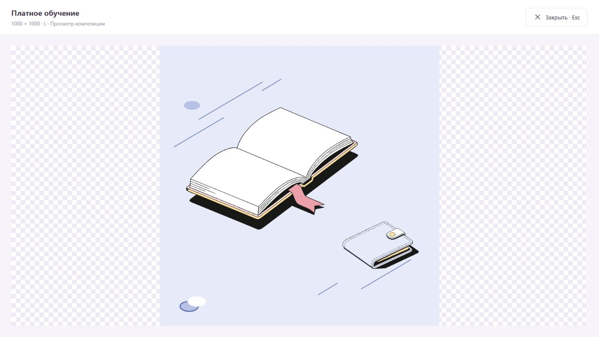

# Проверка этапа редактора

## Детализация автосборки и пользовательские фразы, 0.11.1 — 3 ноября 2026

- В автосборку добавлен явный выбор S/L перед построением. Начальное значение берётся с холста, превью карточек и новые варианты используют выбранный размер. После смены размера старые варианты нельзя применить до перестроения. Закрытие без применения не меняет сцену.
- Исправлены фразы пользователя: «Отдохнуть от постоянных уведомлений.» → наушники + цветы; «Поблагодарить за поддержку.» → цветы; «Начать с чистого листа.» → ручка. Добавлены формы «отдох…», «поблагодар…» и сочетание «с чистого листа»; отдых от звонков не добавляет телефон по теме общения. Проверены отрицания и границы выражения.
- 85 тестов проходят, production-сборка успешна. Проверены варианты и экспорт S/L; исходные контуры телефона — 96 в S и 155 в L.
- В production-интерфейсе Chromium проверены все три фразы, применение S и L, запрет применения старого варианта после смены размера, реальные 96/155 контуров на холсте и закрытие диалога без применения (L сохраняет 155 контуров). Консоль без ошибок.

## Сочетания и перефразировки, 0.11.0 — 3 ноября 2026

Добавлен отдельный словарь сочетаний с приоритетом над общими корнями только внутри найденного фрагмента. Префиксы форм, ограниченные вставки определений, границы предложений и отрицаний, составные запросы и карточки своих SVG проверяются в пяти новых группах тестов. 83 теста проходят. На прежних 63 test-фразах правил: 49 успешных вместо 47, новых регрессий нет; набор знакомый, модель не запускалась. Подробности — [PHRASES.md](PHRASES.md).

Production-сборка успешна. В Chromium проверены «Открыть вклад» → один кошелёк с применением на холст и «Повысить квалификацию и получить награду» → книга + монета, три варианта и объяснения выбора. Консоль без ошибок. Скриншот — `paraphrases.png`.

## Цветовые варианты своего SVG, 0.10.0 — 3 ноября 2026

- Добавлены `paintRolesByRole.main` и `.secondary`, независимые настройки и предпросмотр каждой роли. Геометрия общая для S/L. Для фонового назначения доступны оттенки фона, белый и контуры; есть начальный монохром по яркости. Сброс относится только к активному варианту.
- Старые общие `paintRoles` читаются без изменений, пока нет отдельных назначений; пустая отдельная карта сохраняет исходные цвета только своей роли. При сохранении карточки старые цветные акценты не копируются в фоновую карту; её нужно настроить. Старые проекты не мигрируются при открытии.
- Тесты проверяют одновременный экспорт одного SVG в обеих ролях для трёх палитр и S/L, исходные `d`, прозрачность градиентов/обводок, уникальность ID, отсутствие растра, JSON-перенос, старые карты, пустые карты, неверные роли и проверку неназначенных цветов сразу обеих используемых ролей. 78 тестов проходят, TypeScript и production-сборка успешны.
- В Chromium на production-сборке лестнице назначены главные `object.primary` / `object.secondary`, фоновые `background.strong` / `background.medium`. Главные назначения сохраняются при редактировании фоновых. В бирюзовой палитре переключение роли меняет обводки с `#FFD4F2` / `#6D7BFC` на `#5ABEBE` / `#80DADA`.
- На холсте размещены две копии лестницы с разными ролями; после перезагрузки обе сохранили свои цвета. Реально скачанные JSON и SVG повторно разобраны: обе карты и две векторные группы с соответствующими обводками сохранены, растра нет. Консоль без ошибок.

## Сохранение состава и ролей, 0.9.1 — 3 ноября 2026

- Причина: повторное открытие автосборки использовало исторический `selectionReview`, хотя роли, добавления и удаления на холсте уже изменились. Начальный состав теперь восстанавливается по текущим объектам сцены; история служит только источником объяснений. Дубликаты и сцены больше шести объектов открываются в режиме «На холсте», без потери экземпляров.
- Изменение роли в подборе отмечается как ручное. Переключение автоматических фоновых дополнений сохраняет ручные роли и состав; отключение удаляет только второстепенные дополнения правил. «Подобрать заново» и новая фраза остаются явными способами сбросить подбор.
- Добавлены проверки повторной генерации с пятью seed, переноса через JSON, удалённых/добавленных объектов, дубликатов, отсутствующей истории, смены роли и включения/отключения фоновых дополнений. 73 теста проходят; TypeScript и production-сборка успешны.
- В production-интерфейсе проверено: «Обучение онлайн» → применить → телефон сделать фоновым на холсте → открыть сборку → построить → «Ещё варианты». Роль сохраняется. Затем в подборе телефон сделан главным, книга фоновой, автоматические фоны выключены; после построения и двух нажатий «Ещё варианты» роли сохранились в применённой сцене и скачанном JSON. Повторное открытие и ещё одна генерация также сохраняют роли. Консоль без ошибок.

## Расширение смыслов заготовок, 0.9.0 — 3 ноября 2026

25 тем вместо 18; расширены теги всех десяти встроенных предметов. Проверены опыт, инструкция, исследование, память, ценность, финансовая самостоятельность, умение слушать и составные фразы. Разделены денежные накопления и накопленный опыт; техническая память не добавляет книгу. `npm.cmd test`: 70 passed; production-сборка успешна. На прежних 63 test-фразах правил — 47 успешных, новых регрессий нет. Модель не запускалась; архивные отчёты сохранены. Подробности — [MEANINGS.md](MEANINGS.md).

В production-сборке через Chromium проверены «Услышать клиента» → наушники + телефон с применением на холст и «Исследовать новую идею» → лампа + книга с объяснением исследования. В консоли ошибок нет. Скриншот — `expanded-meanings.png`.

## Компактные настройки автосборки — 3 ноября 2026

«Использовать фоновые предметы» и «Только мои SVG» объединены в строку с переносом при нехватке места; подписи под ними убраны. Проверены окна 1280, 800 и 390 px. Список замены ограничен шириной 150 px, промежуток до кнопки удаления — 12 px, справа сохранён отступ. Проверен подбор «Рост» только из своих SVG при включённых фоновых предметах: три варианта, описаний под переключателями нет. TypeScript и production-сборка проходят.

## Просмотр композиции и удаление модели, 0.8.3 — 3 ноября 2026

- Из интерфейса удалены предложения локальной модели, её загрузчик, Worker и зависимость `@huggingface/transformers`. Отдельное окружение экспериментов в `benchmarks/meaning/` сохранено. Старые JSON с подтверждённым модельным подбором продолжают проходить валидацию.
- После неизвестной фразы предлагается уточнение или ручной выбор; кнопки скачивания модели нет. «Платное обучение» по-прежнему строит варианты одним нажатием.
- «Вписать холст в окно» сбрасывает масштаб и прокрутку. Отдельная кнопка «Посмотреть композицию на весь экран» открывает просмотр на всю площадь окна браузера, без панелей и выделения. Это просмотр внутри окна, не переключение браузера в режим F11.
- В production-сборке проверены открытие, закрытие кнопкой и Esc, возврат фокуса на кнопку открытия. Delete внутри просмотра не удаляет предметы; после выхода состав сохраняется.
- Проверены размеры окна 1280×720 и 390×844, а также квадратный, горизонтальный и вертикальный форматы: SVG использует исходные viewBox 1000×1000, 1200×630, 800×1200. Пропорции сохраняются, горизонтального переполнения на узком экране нет. Консоль без ошибок.
- `npm.cmd test`: 65 passed, 0 failed; `npm.cmd run build`: успешно; `npm.cmd audit --json`: 0 уязвимостей. В `dist` больше нет Worker модели и WASM-файла около 21.6 МБ; отдельной загрузки весов моделью нет.

## Упрощение автосборки, 0.8.2 — 3 ноября 2026

- Фраза → «Построить композицию» сразу выполняет подбор и создаёт три расположения; отдельного обязательного шага проверки предметов нет.
- «Платное обучение» одним нажатием даёт варианты с книгой и кошельком. Состав свёрнут в «Изменить предметы».
- Проверено раскрытие состава, замена кошелька монетой, перестроение и применение: на холсте книга и монета. Старый вариант нельзя применить после изменения состава до перестроения.
- «Космическая ракета» не строит случайную композицию: доступны уточнение, ручной выбор и подсказка; применение недоступно.
- Сборка по названиям и по предметам холста также даёт три варианта.
- Подсказка модели для «Пролить свет на сложный вопрос» предлагает лампу. «Использовать предмет» сразу создаёт три варианта без дополнительного нажатия сборки; применение доступно.
- На экране 390×844 результат получает фокус и виден сразу после построения, переполнения по горизонтали нет. Новый сценарий проверен в Chromium через отдельный dev-сервер; пользовательская сцена не затронута.
- `npm.cmd test`: 65 passed, 0 failed; `npm.cmd run build`: успешно, включая TypeScript.

Полный итоговый проход предыдущей версии 0.8.1 — [FINAL-QA.md](FINAL-QA.md). Ниже сохранена история проверок отдельных этапов.

Проверено 2 ноября 2026 года.

- `npm test`: 16 из 16 тестов проходят. Включены экспорт, исходная геометрия, палитры, размеры и роли, история, слои, проверка проектов и уникальность SVG-определений.
- TypeScript: сборка и `npm run check` проходят.
- Production-сборка Vite: успешна, результат в `dist/`.
- Три SVG из `examples/` отрисованы независимым SVG-рендерером; лист сравнения — `examples.png`.

В браузере проверены:

- Замена L → S: главный телефон меняется со 155 на 96 контуров, книга — с 53 на 51.
- Смена схемы, числовой поворот, дублирование, смена роли и перестановка слоёв.
- Удаление и восстановление через undo.
- Реальное перетаскивание: координаты телефона изменились с 630/660 на примерно 700/590 при заданном перемещении указателя.
- Поиск «обучение» находит книгу; добавление создаёт новый предмет, undo отменяет его.
- Скачивание SVG: файл прочитан как SVG 1000×1000, содержит 311 контуров тестовой сцены из трёх предметов, не содержит растра и рамок выделения.
- Импорт `custom-palette.json`: схема «Черничная» появилась в списке и применилась к композиции.
- Перезагрузка: пользовательская схема и предметы восстановились из браузера.
- Скачивание проекта, создание пустого проекта и обратное открытие JSON восстановили оба предмета и пользовательскую схему.
- Горизонтальный формат даёт viewBox 1200×630. Выключение фона удаляет фон из сцены.
- Широкая компоновка 1440×1000 и узкие окна 566×668, 390×844. На узких экранах настройки переходят ниже; горизонтального переполнения страницы не обнаружено.
- На финальном проходе консоль браузера не содержит ошибок.

Снимок широкого интерфейса — `editor.png`. Экспорт в Figma/Illustrator пока не проверялся: это отдельная проверка в целевом векторном редакторе.

## Этап автоматической компоновки, версия 0.3.0

- 24 автоматических теста проходят, в том числе 8 новых тестов компоновки. Проверены S/L, три формата, 1–6 неодинаковых и повторяющихся предметов, отступы и ограничение перекрытий.
- Проверено, что неизвестные названия блокируют сборку, повторения сохраняются отдельными экземплярами, исходная сцена не мутирует, а один seed воспроизводит результат.
- В браузере: «книга, ракета» даёт явную ошибку. Семь предметов дают ошибку лимита. Единственный фоновый предмет даёт объяснение о необходимости главного; главный телефон даёт три варианта.
- «Книга, телефон, ручка» создаёт три превью. Изменение роли блокирует применение старых вариантов до пересчёта.
- Добавление фонового предмета включается отдельно; для проверенного запроса алгоритм добавил пазлы. Фоновые пазлы и ручка оказались за главными книгой и телефоном.
- Применение изменило сцену с двух до четырёх предметов. Undo вернул два, redo восстановил четыре. Закрытие следующего окна без применения не изменило сцену.
- Реально скачанный SVG прочитан: четыре отдельные группы, две главные и две фоновые; растра и рамок выделения нет.
- Окно проверено в компоновках 1440×1000, 566×668 и 390×844. На узком экране блоки переходят в одну колонку, содержимое прокручивается внутри окна; горизонтального переполнения страницы и тела окна не обнаружено.
- Консоль браузера на финальном проходе без ошибок. Снимок окна — `autocompose.png`.
- `examples/automatic/` содержит три SVG и соответствующие JSON-проекты, созданные текущим алгоритмом из демонстрационных наборов.

Подбор по свободной метафоре не заявляется: это следующий этап, отдельный от буквального распознавания названий.

## Этап локального смыслового подбора, версия 0.4.0

Предыдущая оговорка относится к версии 0.3.0. В текущей версии добавлен локальный разбор поддерживаемых тем и метафор; универсальная AI-интерпретация не заявляется.

- 33 автоматических теста, в том числе 9 новых: темы, устойчивые выражения, отрицания, границы фраз, неизвестные/частичные темы, ограниченный каталог, роли, проверка сохранённых объяснений и путь от темы до SVG для S/L и трёх форматов.
- В браузере «Обучение онлайн» выбрало телефон и книгу с объяснениями цифрового доступа и знаний.
- «Космическая ракета» вернула отсутствие смысловой связи и предмета в библиотеке: ноль вариантов, применение недоступно.
- «Безопасные покупки без телефона» выбрало монету и кошелёк; телефон явно отмечен как исключённый.
- «Финансовая подушка» выбрала кошелёк и монету. «Полёт мысли» выбрал лампу и, при разрешении фоновых предметов, ручку.
- После применения «Полёта мысли» в редакторе два предмета. JSON содержит `interpretation.provider = local`, исходную формулировку и объяснения; после перезагрузки проект восстановился.
- Новая сборка того же проекта по названиям сохранила предметы и очистила `interpretation`. Ранее сохранённый смысловой проект снова открылся через загрузку файла.
- Скачанный SVG прочитан как вектор 1000×1000 с двумя отдельными группами предметов и без встроенного растра.
- Снимок интерфейса смыслового подбора — `meaning.png`. Три готовых смысловых примера — `examples/meaning/`.
- Повторное открытие смыслового проекта восстановило включённую настройку фоновых предметов. На экране 390×844 три варианта доступны, горизонтального переполнения страницы/окна нет. Закрытие без применения сохранило два предмета исходной сцены; консоль без ошибок.

Живые запросы к OpenAI или другим моделям не выполнялись: по выбору пользователя реализация работает без ключа и внешнего сервиса.

## Исправление составных тем, версия 0.4.1

«Платное обучение» ранее теряло тему оплаты: корень «платн» отсутствовал в словаре. Добавлены признаки платности/стоимости. При выборе главных предметов теперь сначала покрываются отдельные темы, затем используется общий рейтинг. Это сохраняет оплату и в трёхчастном запросе «Платное онлайн-обучение».

- Платное обучение / платное образование / стоимость обучения / обучение с оплатой → книга и денежный предмет.
- Платное онлайн-обучение → книга, кошелёк и телефон.
- Бесплатное обучение / платформа для обучения → денежные предметы не добавляются.
- Все 34 теста проходят.

## Подтверждение пользователя

2 ноября 2026 года пользователь подтвердил, что открытие и редактирование экспортированного SVG в векторном редакторе работает. Это подтверждение пользователя; конкретный редактор отдельно не уточнялся.

Для ручной проверки загрузки добавлен `examples/palette-forest.json` — палитра «Лесная» с зелёными фоновыми цветами и тёплыми акцентами предметов. Нейтральные цвета сохранены согласно формату сервиса.

## Пользовательские SVG (0.5)

Автотесты `tests/custom.test.mjs`: неизменность путей, цвета и viewBox; безопасный статический импорт и отклонение активных/внешних элементов; карточки, сочетания, общие смысловые темы и отрицания; подбор только своих предметов; три компоновки, переносимый JSON и векторный экспорт; совместимость старых проектов и валидация метаданных.

В браузере проверены: загрузка `examples/custom/ladder.svg`, редактирование карточки, «Путь к успеху» с «Только мои SVG», применение варианта, скачивание SVG и проекта, повторное открытие файла проекта.

Результат: 39 автотестов прошли; production-сборка успешна. Проверены также восстановление библиотеки после перезагрузки и отсутствие ошибок в консоли. Скриншот: `docs/custom-svg.png`. Исходная пользовательская композиция после проверки восстановлена.

Адаптивная кнопка импорта SVG: в браузере проверены ширины 1280, 900 и 390 px. Подпись меняется с полной на «Свои SVG», шрифт — 12/11/10 px, горизонтального переполнения кнопки нет. Скриншот: `docs/responsive-upload.png`.

## Ручное назначение цветов (0.6)

43 теста прошли. Новые проверки: нормализация HEX/RGB/процентов/основных имён и alpha; обнаружение заливок, обводок, градиентов и currentColor; перекраска по всем встроенным палитрам с сохранением alpha, opacity, путей и локальных ссылок; сохранение назначений в JSON, совместимость старых файлов и отклонение неверных ролей/цветов.

Браузер: открыта лестница, два исходных цвета назначены акцентам; переключены палитры в предпросмотре; проверены разные цвета на холсте после сохранения и смены схемы, включая обновление кеша. SVG и проект скачаны, проект повторно открыт, назначения восстановлены. Сброс возвращает исходные цвета в предпросмотре, закрытие не сохраняет сброс. Узкий диалог доступен прокруткой и клавиатурой; ошибок в консоли нет. Исходный пользовательский проект восстановлен. Скриншот `docs/custom-colors.png`.

## Сравнение смыслового подбора

Отдельный эксперимент `benchmarks/meaning/`: 90 размеченных до inference фраз, 27 calibration / 63 test, зафиксированная ONNX q8 модель multilingual MiniLM и текущие правила без изменений. Локальный запуск выполнен, полный результат — `benchmarks/meaning/results/comparison.json`, методика и ограничения — `benchmarks/meaning/REPORT.md`. Модель не подключена к приложению.

48 корневых тестов прошли. Пять новых проверок в `tests/meaning-benchmark.test.mjs` проверяют альтернативные эталонные группы, дополнения/запреты, отказ от подбора, отбор по порогам, разделение набора и независимый пересчёт опубликованных оценок. Веса модели и дополнительные node_modules не включены в Git; CI не скачивает модель.

## Подсказки модели после пустого ответа правил

Эксперимент выполнен на 60 новых фразах (18 calibration / 42 test), без повторов прежнего набора. Протокол и эталон зафиксированы до inference. Описания предметов, модель и исходные правила сохранены. Отчёт `benchmarks/meaning/FALLBACK-REPORT.md`, полные данные `benchmarks/meaning/results/fallback.json`. Вызов модели пропускается для непустых ответов правил, включая partial.

53 корневых теста прошли. Пять новых в `tests/meaning-fallback.test.mjs` проверяют сохранение ответов правил, пороги/отрыв/исключения, отсутствие утечки эталонных запретов, пользу основной подсказки, запрет настройки на test, возможность не предлагать ничего и независимый пересчёт опубликованных результатов. В CI модель не скачивается. Строгий режим дал 6 полезных подсказок из 6 на новом test, оставив ещё 5 положительных пропусков; это малый авторский набор и не гарантия качества. Экспериментальный интерфейс в приложение не добавлялся.

## Подтверждение и исправление подбора в приложении (0.7)

57 тестов прошли; production-сборка успешна. Четыре новых теста в `tests/selection-review.test.mjs`: редактирование без мутации, роли/дубликаты/лимиты/исключения; совпадение текстовых карточек с benchmark; воспроизведение строгих решений на замороженных cosine-рейтингах; сохранение подтверждённой модели, валидация и undo.

В браузере реально запущена ONNX q8 MiniLM через WASM Web Worker. Dev и production (preview на 4187) предложили лампу для «Пролить свет на сложный вопрос». Подтверждение → три варианта → редактор → SVG/проект → повторное открытие сохранили выбор. Неподтверждённое предложение оставляет состав пустым. «Пропустить» в production не добавляет предмет. Отмена загрузки и новая фраза «Платное обучение» не подставляют устаревшую подсказку. «Лунный посадочный модуль» завершился без надёжного кандидата, с доступным ручным выбором. В production с фильтром «Только мои SVG» для «От стажёра до руководителя» предложена загруженная лестница.

Ручная коррекция в браузере: заменить лампу ручкой, найти/добавить книгу, убрать ручку, собрать варианты — состав остаётся выбранным вручную. Узкая панель доступна прокруткой и клавиатурой. Скриншоты `docs/model-suggestion.png`, `docs/selection-review.png`. Консоль без ошибок; исходная пользовательская композиция с собственным SVG восстановлена. Финальные примеры без пользовательских данных — `examples/reviewed/model.*` и `examples/reviewed/manual.*`.

Первая загрузка модели/токенизатора порядка 130 МиБ, runtime отдельно. Проверены реальные загрузка, повторный запуск и отказ по строгому порогу; офлайн-режим на новом устройстве без ранее загруженных файлов не обещается. Итоги benchmark на Node CPU не являются гарантией браузерного качества или производительности на телефонах.

## Проверка перед экспортом (0.8)

65 тестов прошли; production-сборка успешна. Восемь новых проверок в `tests/preflight.test.mjs`: касание/выход/поворот; S/L, формат и масштаб; точный порог 28% и слои; тонкие параллельные повёрнутые рамки без ложного overlap; полностью невидимые перекрытия; только используемые custom-цвета и дедупликация; неподдерживаемые цветовые записи; отсутствие мутаций и побайтовое равенство SVG до/после проверки.

В браузере открыт `examples/preflight/needs-review.sostav.json`. Найдены выход книги, перекрытие кошелька/монеты и исходные цвета лестницы. Выбор книги открыл её координаты с фокусом X. После изменения координат/поворота замечание о выходе исчезло. «Настроить цвета» сразу сфокусировало палитру; после назначения обоих цветов заметка исчезла. Delete в диалоге не удалил предмет. «Скачать без исправлений» скачало SVG при оставшихся перекрытиях. На `clean.sostav.json` показано «Замечаний не найдено»; Escape закрыл диалог, затем чистый экспорт скачан из диалога.

Проверен узкий экран 390×844: диалог 358.4×759.6, горизонтального переполнения нет, список прокручивается, действия доступны. Скриншоты `docs/preflight.png`, `docs/preflight-mobile.png`. В консоли ошибок нет. Исходный проект пользователя восстановлен, размер окна возвращён.
